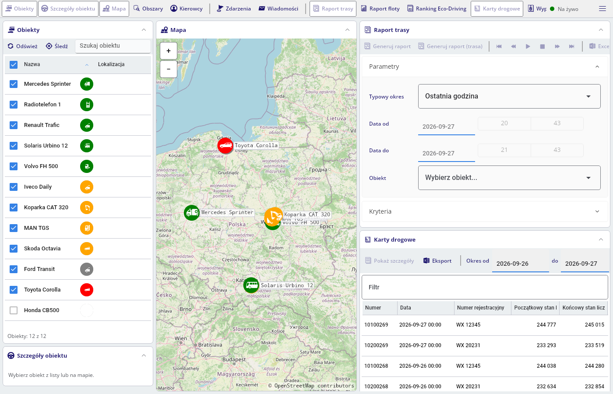
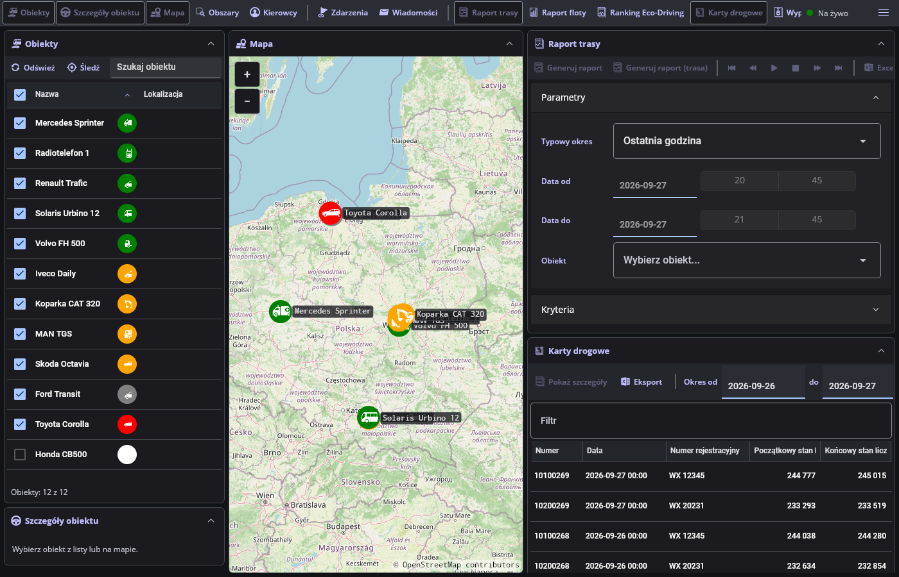
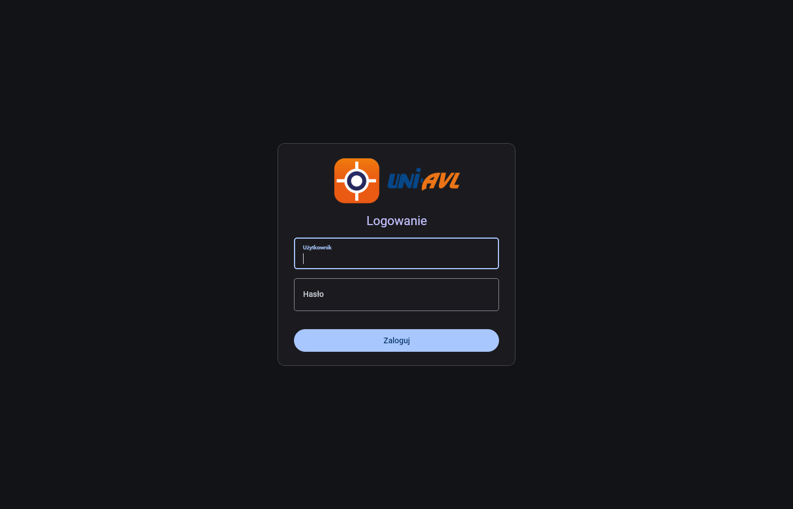
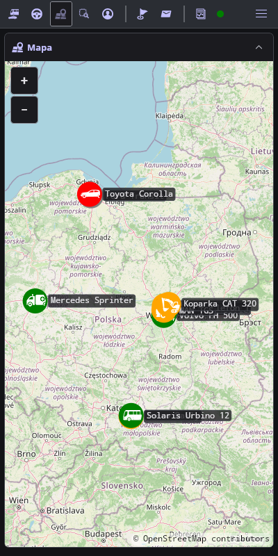

# Motywy interfejsu

## Rozwiązanie

| Element | Stan |
|---|---|
| Wybór | menu boczne (przycisk ☰), lista „Motyw”: Jasny, Ciemny, Zgodny z systemem |
| Wartość domyślna | Jasny — wygląd aplikacji Blazor |
| Zapis | ustawienia lokalne urządzenia (`ApplicationData.LocalSettings`, w przeglądarce — `localStorage`) |
| Zastosowanie | przy uruchomieniu aplikacji (`Application.RequestedTheme`); zmiana obowiązuje po ponownym uruchomieniu, w przeglądarce — po przeładowaniu strony. Jeden motyw całej aplikacji obejmuje także okna podręczne i zasoby pobierane w kodzie |
| Paleta | `Styles/ColorPaletteOverride.xaml`: słowniki `Light` i `Dark` z tymi samymi zasobami; kolory statusów obiektów bez zmian (test `PaletteTests`) |
| Ikony paska narzędzi, nagłówków paneli i szczegółów obiektu | pliki źródłowe jednobarwne w kolorze akcentu (`#1A126C`) — rysowane jako ikona jednobarwna w kolorze `FlotaAccentBrush`: w motywie jasnym bez zmian, w ciemnym `#C3C0FF` |
| Mapa | podkład OpenStreetMap w obu motywach jasny |

## Zrzuty ekranu

Wersja przeglądarkowa, dane symulatora UniAVL ([SYMULATOR.md](SYMULATOR.md)).

| Motyw jasny | Motyw ciemny |
|---|---|
|  |  |

| Motyw ciemny — logowanie | Motyw ciemny — 400 px |
|---|---|
|  |  |

## Uwagi

- Logo UNI-AVL (`logo.png`, ekran logowania i menu boczne) ma granatowy napis „UNI”, słabo widoczny na ciemnym tle; wariant logo dla motywu ciemnego wymaga pliku od właściciela znaku.
- Obiekt o statusie „Nieznany” ma biały znacznik (kolor statusu z aplikacji Blazor) — w motywie ciemnym wyraźnie odróżnia się od tła.
