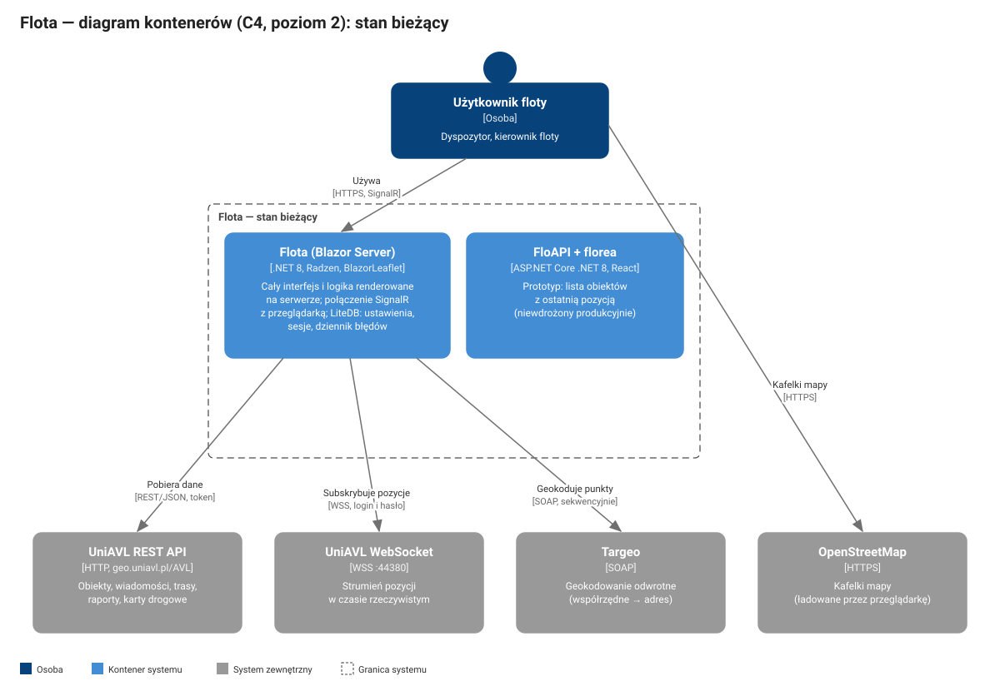
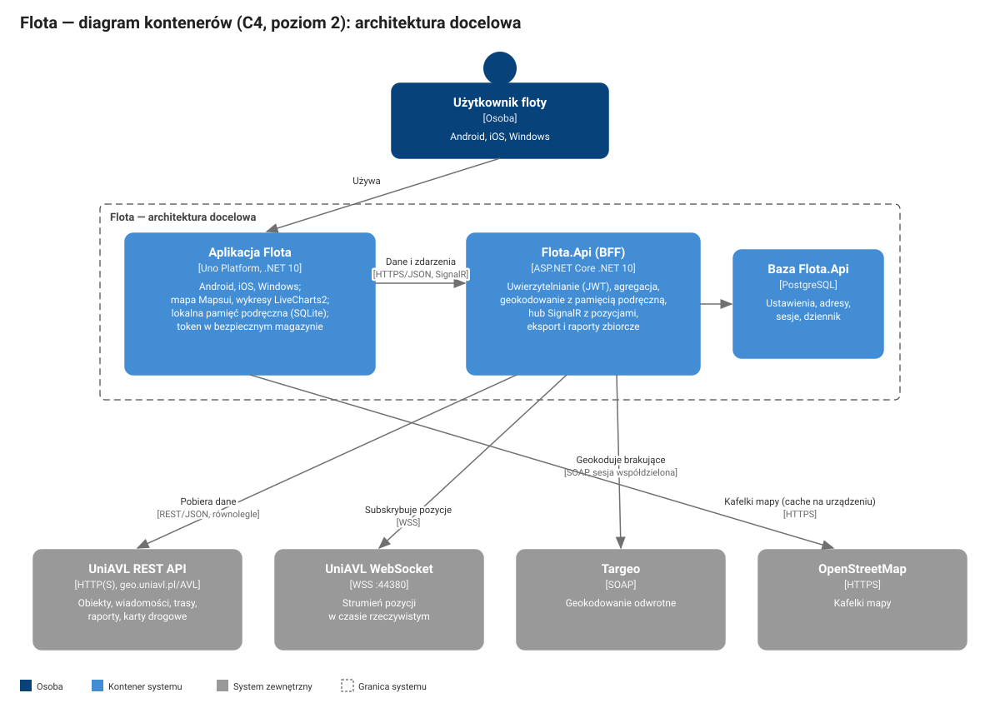

# Flota — analiza i plan przeniesienia na Uno Platform

| | |
|---|---|
| Przedmiot | Przeniesienie aplikacji Flota (Blazor Server) na Uno Platform z wersjami na Android, iOS i Windows |
| Rozwiązanie źródłowe | `C:\Projects\Flota` |
| Rozwiązanie docelowe | `C:\Projects\FlotaUno` (nazwa robocza, nowy katalog obok `Flota`) |
| Wykonawca | Claude Code, zgodnie z zasadami w [`CLAUDE.md`](CLAUDE.md) |
| Wersja dokumentu | |
| Data | |
| Autor | |

## Spis treści

1. [Cel i zakres](#1-cel-i-zakres)
2. [Stan bieżący](#2-stan-bieżący)
3. [Przyczyny długiego ładowania danych](#3-przyczyny-długiego-ładowania-danych)
4. [Problemy bezpieczeństwa i poprawności](#4-problemy-bezpieczeństwa-i-poprawności)
5. [Architektura docelowa](#5-architektura-docelowa)
6. [Optymalizacja — rozwiązania i mierniki](#6-optymalizacja--rozwiązania-i-mierniki)
7. [Interfejs, kolorystyka i elementy graficzne](#7-interfejs-kolorystyka-i-elementy-graficzne)
8. [Plan realizacji](#8-plan-realizacji)
9. [Testy i kontrola jakości](#9-testy-i-kontrola-jakości)
10. [Dystrybucja](#10-dystrybucja)
11. [Ryzyka](#11-ryzyka)
12. [Kwestie do rozstrzygnięcia](#12-kwestie-do-rozstrzygnięcia)
13. [Załącznik A — punkty końcowe UniAVL API](#załącznik-a--punkty-końcowe-uniavl-api)
14. [Załącznik B — odwzorowanie elementów źródłowych](#załącznik-b--odwzorowanie-elementów-źródłowych)

---

## 1. Cel i zakres

Celem jest zbudowanie nowej aplikacji klienckiej systemu Flota na Uno Platform, działającej na systemach Android, iOS i Windows oraz w przeglądarce internetowej (następca aplikacji Blazor), przy spełnieniu następujących wymagań:

- pełna funkcjonalność aplikacji Blazor (zakres funkcji z aplikacji WPF UniNet.AVL — zob. [rozdział 12](#12-kwestie-do-rozstrzygnięcia));
- istotne skrócenie czasu ładowania danych;
- zachowanie kolorystyki i elementów graficznych (logo, ikony obiektów, ikony funkcji, strzałki kierunku);
- dopuszczalne dopracowanie projektu graficznego, w szczególności pod kątem urządzeń mobilnych.

Nowe rozwiązanie powstaje w osobnym katalogu `C:\Projects\FlotaUno`. Rozwiązanie `C:\Projects\Flota` pozostaje bez zmian i stanowi materiał źródłowy.

Rozdziały 2–7 stanowią analizę i specyfikację; rozdział 8 zawiera zadania do wykonania przez Claude Code wraz z kryteriami weryfikacji i punktami kontrolnymi wymagającymi akceptacji.

## 2. Stan bieżący

### 2.1. Składniki repozytorium `C:\Projects\Flota`

| Składnik | Technologia | Rola | Przeniesienie |
|---|---|---|---|
| `Flota` | Blazor Server, .NET 8, Radzen.Blazor 4.29 | Aplikacja produkcyjna (wersja 0.17.4.1): mapa, lista obiektów, raporty, słowniki | Źródło funkcji i zasobów graficznych |
| `Flota.Data` | .NET 8, RestSharp, LiteDB, ClosedXML, klient WCF | Model danych, klient UniAVL API, geokodowanie Targeo, eksport XLSX | Model i reguły biznesowe — do przepisania w `Flota.Core` i `Flota.Api` |
| `BlazorLeaflet` | Blazor, Leaflet 1.6 | Obsługa mapy (markery, linie, wielokąty) | Nie — zastąpione przez Mapsui |
| `FloAPI` | ASP.NET Core .NET 8 | Prototyp API: lista obiektów z ostatnią pozycją, token | Koncepcja rozwinięta w `Flota.Api` |
| `florea` | React 18, Vite, react-leaflet | Prototyp klienta WWW korzystającego z `FloAPI` | Nie |
| `UniNet.AVL.Modules.*`, `UniNet.AVL.Model.DTO`, `UniNet.AVL.Services.CommunicationService` | WPF, DevExpress 20.2, SignalR (kod zdekompilowany) | Wcześniejsza aplikacja Windows: moduły pojazdów, raportów i komunikacji | Źródło referencyjne modelu DTO i funkcji niedostępnych w Blazor |
| `BlazorLeaflet — kopia`, `florea.old`, `FloAPI-full`, pliki `*.bak`, `Index.razor`, `Index-b.razor`, `Test.razor`, `Page.razor` | — | Kopie robocze i strony testowe | Nie |

Główna logika interfejsu znajduje się w dwóch komponentach: `Flota/Pages/Index-a.razor` (3161 wierszy, ścieżka `/`) oraz `Flota/Components/Reports.razor` (1968 wierszy, klasa bazowa strony głównej).

### 2.2. Architektura bieżąca



Aplikacja Blazor Server wykonuje cały interfejs na serwerze i komunikuje się z przeglądarką przez SignalR. Serwer aplikacji korzysta z czterech systemów zewnętrznych:

| System | Protokół | Zastosowanie |
|---|---|---|
| UniAVL REST API (`http://geo.uniavl.pl/AVL/`) | HTTP, JSON, nagłówek `Authorization: Token …` | Wszystkie dane: obiekty, wiadomości, trasy, raporty, karty drogowe, słowniki |
| UniAVL WebSocket (`wss://geo.uniavl.pl:44380`) | WSS, logowanie poleceniem `LOGIN <użytkownik> <hasło>` | Pozycje obiektów w czasie rzeczywistym |
| Targeo (`mapa.targeo.pl`) | SOAP (WCF) | Geokodowanie odwrotne: współrzędne → adres |
| OpenStreetMap | HTTPS | Kafelki mapy |

Dane lokalne serwera aplikacji są przechowywane w plikach LiteDB: `Settings.db` (domyślny widok mapy użytkownika), `Sessions.db` (rejestr logowań), `Errors.db` (dziennik błędów), `Addresses.db` (lokalna baza adresów, 12 MB, wykorzystywana wyłącznie przez nieużywaną ścieżkę `OpenStreetAddress`).

### 2.3. Inwentarz funkcji

Poniższa tabela jest listą kontrolną parytetu funkcjonalnego. Kolumna „WPF” wskazuje funkcje obecne w aplikacji UniNet.AVL.

| Obszar | Funkcja | Blazor | WPF | Źródło danych |
|---|---|---|---|---|
| Sesja | Logowanie, wylogowanie, odnowienie tokenu | tak | tak | `api/Login/Token`, `api/Login/Ping`, `api/Login/Identity` |
| Mapa | Mapa OSM z markerami obiektów (ikona typu pojazdu, kolor statusu) | tak | tak | `api/TrackingObjects`, `api/TrackingMessages/Last` |
| Mapa | Aktualizacja pozycji w czasie rzeczywistym | tak | tak | WebSocket / SignalR |
| Mapa | Tryb „Śledź” — ślad bieżącego przejazdu wybranego obiektu | tak | tak | WebSocket |
| Mapa | Obszary (strefy) — rysowanie wielokątów | tak | tak | `api/Areas` |
| Mapa | Widok początkowy: zapis, przejście, usunięcie (menu kontekstowe) | tak | — | LiteDB `Settings.db` |
| Mapa | Strzałki kierunku jazdy na śladzie | tak | tak | dane wiadomości |
| Obiekty | Lista obiektów: sortowanie, filtrowanie, zaznaczanie widoczności na mapie | tak | tak | jw. |
| Obiekty | Szczegóły obiektu: urządzenie, czujniki, licznik, paliwo, adres | tak | tak | jw. |
| Obiekty | Obliczanie odległości | — | tak | — |
| Raport trasy | Trasa (etapy, rysowanie na mapie, odtwarzanie: start, stop, pierwszy, poprzedni, następny, ostatni) | tak | tak | `…/TrackingMessages/Route` |
| Raport trasy | Kursy, Podsumowanie kursów | tak | tak | jw. |
| Raport trasy | Punkty trasy z dynamicznymi kolumnami czujników | tak | tak | `…/TrackingMessages?stageType=` |
| Raport trasy | Paliwo: tankowania, ubytki, wykres ilości paliwa w funkcji czasu i drogi | tak | tak | `…/FuelReport` |
| Raport trasy | Zdarzenia | tak | tak | `…/Events` |
| Raport trasy | Styl jazdy (wykres) | tak | tak | `…/DrivingStyle` |
| Raporty zbiorcze | Raport floty — podsumowanie i szczegóły, eksport XLSX | tak | tak | `…/FleetReport` |
| Raporty zbiorcze | Ranking Eco-Driving | tak | tak | `…/DrivingStyle` |
| Raporty zbiorcze | Raport pracy poza godzinami | — | tak | do ustalenia |
| Karty drogowe | Lista i szczegóły kart drogowych | tak | — | `api/Logbooks`, `api/Logbooks/{id}/Details` |
| Słowniki | Kierowcy | tak | tak | `api/Users/Drivers` |
| Słowniki | Wyposażenie (odczyt, eksport XLSX) | tak | tak | `api/Equipment` |
| Słowniki | Wyposażenie — dodawanie, modyfikacja, usuwanie | — | tak | do ustalenia |
| Zdarzenia | Szablony zdarzeń i przypomnienia (odczyt) | tak | tak | `…/EventTemplates` |
| Zdarzenia | Szablony zdarzeń i przypomnienia — dodawanie, modyfikacja, usuwanie | — | tak | do ustalenia |
| Komunikacja | Wiadomości tekstowe do urządzeń i grup, nagrania głosowe | — | tak | hub SignalR UniAVL |
| Komunikacja | Tachograf — żądanie odczytu | — | tak | do ustalenia |
| Administracja | Sesje, dziennik błędów, historia zmian | tak | — | LiteDB, `changelog.md` |

### 2.4. Kolorystyka i zasoby graficzne

**Kolory.** Aplikacja korzysta z motywu Radzen Material 3 (`wwwroot/css/material3-base.css`), własnego arkusza `site.css` oraz kolorów zapisanych bezpośrednio w komponentach.

| Rola | Wartość | Źródło |
|---|---|---|
| Logo — pomarańczowy | `#EA5A12`, `#EA7416` | `images/logo.png` |
| Logo — niebieski | `#064789` | `images/logo.png` |
| Logo — granatowy | `#27285C` | `images/logo.png` |
| Akcent etykiet i poleceń („Odśwież”, „Śledź”, nagłówki) | `#1A126C` | `Index-a.razor` |
| Kolor podstawowy (primary) | `#3481E5`, ciemny `#375A8B`, najciemniejszy `#00215D` | `material3-base.css` |
| Kolor drugorzędny (secondary) | `#5B6471` | `material3-base.css` |
| Tło aplikacji | `#EBEFF1` | `Index-a.razor` |
| Status: w ruchu | `#008000` | `TrackingObject.ButtonBackgroundColor` |
| Status: postój | `#FFA500` | jw. |
| Status: brak poprawnego GPS | `#808080` | jw. |
| Status: dane nieaktualne | `#FF0000` | jw. |
| Błąd (danger) | `#B3261E` | `material3-base.css` |

**Kroje pisma.** Roboto (300, 400, 500, 700), Source Sans Pro, Material Icons (`wwwroot/fonts`).

**Ikony i grafika** (`Flota/wwwroot/images`, 172 pliki; kopia w `Flota/Images/AVL` pochodzi z aplikacji WPF):

| Grupa | Liczba i format | Przykłady |
|---|---|---|
| Ikony funkcji | pary 16×16 i 32×32 px, PNG | `tracking_objects`, `map`, `reports`, `reports_daily`, `reports_eco`, `logbook`, `areas`, `drivers`, `equipment`, `events`, `messages`, `excel`, `play`, `stop`, `first`, `last` |
| Ikony typów obiektów | 23 pliki 64×64 px, PNG | `to_car`, `to_van`, `to_truck`, `to_tractor_unit`, `to_bus`, `to_ambulance`, `to_excavator` |
| Strzałki kierunku | 8 plików 24×24 px (co 45°) oraz wariant `arrows-o` | `arrow_0` … `arrow_315` |
| Ikony zdarzeń | PNG | `event_fuel`, `event_doors`, `event_alcotest` |
| Stany | PNG | `ignition_enabled`, `ignition_disabled`, `tracking_mode_*` |
| Inne | PNG, GIF, JPG | `logo.png`, `logo-login.png`, `login.jpg`, `background.png`, `load-big.gif` |

Ikony rastrowe 16 i 32 px są niewystarczające dla ekranów o gęstości 3× (iPhone, większość telefonów Android) — bez przygotowania wersji wektorowych lub większych będą nieostre.

## 3. Przyczyny długiego ładowania danych

Analiza kodu wskazuje następujące przyczyny, uszeregowane według szacowanego wpływu. Rzeczywisty udział każdej z nich zostanie zmierzony w fazie 0 (zob. [8.1](#81-faza-0--pomiary-i-weryfikacja-założeń)).

| # | Przyczyna | Miejsce w kodzie | Skutek |
|---|---|---|---|
| P1 | **Geokodowanie odwrotne wykonywane sekwencyjnie i synchronicznie.** Dla każdego punktu wywoływane jest `revGeocodeAsync(...).Result` w pętli; brak pamięci podręcznej adresów. | `Flota.Data/AVL/Address.cs` — `GetAsync(pointGPS[])` | Czas ładowania rośnie liniowo z liczbą obiektów i punktów trasy; każdy punkt to osobne wywołanie SOAP. Dotyczy startu aplikacji, raportów tras i punktów trasy. |
| P2 | **Każda wiadomość WebSocket powoduje logowanie do Targeo, geokodowanie i wylogowanie** (trzy wywołania SOAP), wykonywane blokująco (`.Result`) w obsłudze zdarzenia. | `Index-a.razor` — `WebsocketMessageReceived`; `Address.GetAsync(pointGPS)` | Opóźnienia interfejsu przy intensywnym strumieniu pozycji; zbędne obciążenie Targeo. |
| P3 | **Ciągły cykl renderowania.** `OnAfterRenderAsync` przy każdym renderowaniu wywołuje `UpdateWindowSize`, który wykonuje dwa wywołania JS interop i bezwarunkowo `StateHasChanged()`, co wywołuje kolejne renderowanie. | `Index-a.razor` — `OnAfterRenderAsync`, `UpdateWindowSize` | Stałe obciążenie procesora serwera i łącza SignalR przez cały czas otwarcia strony; spowolnienie wszystkich pozostałych operacji. |
| P4 | **Sekwencyjna sekwencja startowa z powtórzeniami.** Kolejno: `Ping` (synchronicznie), `Identity` (synchronicznie), `Settings`, `api/TrackingObjects`, `api/TrackingMessages/Last`, geokodowanie wszystkich pozycji, ponownie `api/TrackingObjects` (`GetListAsync4Sel`), `api/Areas`. | `Index-a.razor` — `OnAfterRenderAsync(firstRender)` | Suma opóźnień wszystkich wywołań zamiast maksimum; lista obiektów pobierana dwukrotnie. Mapa pojawia się dopiero po zakończeniu całości. |
| P5 | **Zapytania N+1 w raportach.** Pętle „obiekt × etap” wykonują osobne, sekwencyjne żądania HTTP. | `TrackingMessage.GetListAsync4StageType`, `TrackingMessage.GetListAsync(IList<TrackingObject>…)`, `Route.cs` | Czas raportu proporcjonalny do liczby obiektów i etapów. |
| P6 | **Nowy klient HTTP dla każdego żądania**, bez współdzielenia połączeń; `MaxTimeout = -1` (brak limitu czasu). | `Flota.Data/AVLClient.cs` | Koszt zestawiania połączenia przy każdym żądaniu; zawieszone żądanie blokuje ekran bez końca. |
| P7 | **Podwójna deserializacja JSON.** Odpowiedź jest parsowana do `JsonNode`, a następnie każdy element serializowany do tekstu i ponownie deserializowany. | `TrackingObject.cs`, `TrackingMessage.cs`, pozostałe klasy `Flota.Data/AVL` | Kilkukrotnie większe zużycie pamięci i procesora przy dużych odpowiedziach (punkty trasy). |
| P8 | **Dopasowanie wiadomości do obiektów o złożoności kwadratowej** (zagnieżdżone pętle po listach czujników, `List.Contains`). | `TrackingObject.RefreshMessages*`, `TrackingMessage.GetListAsyncLast` | Zauważalne przy kilkuset obiektach. |
| P9 | **Powtórne logowanie przy każdym nieudanym żądaniu.** `AVLClient.GetResponseAsync` pobiera nowy token przy dowolnym błędzie (nie tylko 401). | `Flota.Data/AVLClient.cs` | Każdy błąd serwera podwaja liczbę żądań. |
| P10 | **Brak wirtualizacji tabel** (`RadzenDataGrid` bez `AllowVirtualization`) i odtwarzanie warstw mapy przez JS interop marker po markerze. | `Index-a.razor`, `Reports.razor` | Długie renderowanie tabel punktów trasy i mapy przy wielu obiektach. |

## 4. Problemy bezpieczeństwa i poprawności

Poniższe rozwiązania nie mogą zostać przeniesione do nowej aplikacji. Pozycje B1–B3 wymagają działania niezależnie od migracji.

| # | Problem | Miejsce | Działanie |
|---|---|---|---|
| B1 | Dane uwierzytelniające zapisane w kodzie źródłowym i w repozytorium git: konto Targeo, konto użytkownika UniAVL, hasła plików LiteDB. | `Flota.Data/Targeo/Authorization.cs`, `Flota.Data/WebSocketLocation.cs`, `Flota.Data/AVL/TokenSimple.cs`, `Settings.cs`, `Session.cs`, `LocalAddress.cs` | Zmiana haseł; w nowym rozwiązaniu wyłącznie konfiguracja serwerowa (User Secrets, zmienne środowiskowe, magazyn sekretów). Dane uwierzytelniające Targeo nie mogą trafić do aplikacji mobilnej. |
| B2 | Statyczna właściwość `Settings.User` (token bieżącego użytkownika) współdzielona przez wszystkie obwody Blazor Server — przy równoczesnej pracy wielu użytkowników żądania mogą zostać wykonane z tokenem innego użytkownika. | `Flota.Data/Settings.cs`, `TrackingObject.GetListAsync(bool, string)`, `AVLClient` | W nowym rozwiązaniu kontekst użytkownika wyłącznie przez wstrzykiwanie zależności w zakresie żądania. |
| B3 | Login i hasło przekazywane w parametrach zapytania do `api/Login/Token` przez HTTP (bez TLS) oraz przechowywane w `sessionStorage` przeglądarki w celu logowania do WebSocket. | `Token.cs`, `AVLClient.GetToken`, `Index-a.razor` | Ustalenie z dostawcą UniAVL dostępności HTTPS; hasło użytkownika nie jest przechowywane na urządzeniu. |
| B4 | Komunikaty o błędach ze stosem wywołań wyświetlane użytkownikowi. | `Index-a.razor`, `Reports.razor` | Komunikaty dla użytkownika bez szczegółów technicznych; szczegóły w dzienniku serwera. |
| B5 | Obsługa zdarzeń w metodach `async void` z blokującymi wywołaniami `.Result`. | `Index-a.razor`, `Address.cs` | W nowym kodzie wyłącznie `async Task` i anulowanie przez `CancellationToken`. |

## 5. Architektura docelowa



### 5.1. Decyzje architektoniczne

| # | Obszar | Decyzja | Uzasadnienie |
|---|---|---|---|
| D1 | Platforma | Uno Platform, `Uno.Sdk` w najnowszej wersji stabilnej (6.7.30 według NuGet), .NET 10 (LTS) | Jeden projekt i jeden kod XAML/C# dla Android, iOS i Windows; zgodność z WinUI 3. |
| D2 | Platformy docelowe | `net10.0-android`, `net10.0-ios`, `net10.0-windows10.0.26100` (Windows App SDK), `net10.0-browserwasm` (WebAssembly) | Windows w wariancie natywnym WinUI (MSIX); Android, iOS i przeglądarka z rendererem Skia (domyślnym w Uno 6). Wersja przeglądarkowa zastępuje aplikację Blazor ([faza 9](#810-faza-9--wersja-przeglądarkowa)). |
| D3 | Warstwa pośrednia | Nowa usługa **Flota.Api** (ASP.NET Core .NET 10) w roli BFF (backend for frontend) pomiędzy aplikacją a UniAVL | Ukrycie danych uwierzytelniających Targeo; wspólna pamięć podręczna adresów dla wszystkich użytkowników; agregacja wielu wywołań UniAVL w jedno; równoległe pobieranie po stronie serwera o niskich opóźnieniach; kompresja i kontrakty dopasowane do ekranów mobilnych. Rozwija koncepcję prototypu `FloAPI`. |
| D4 | Wzorzec prezentacji | MVVM z `CommunityToolkit.Mvvm` (generatory źródłowe) | Zgodność z dotychczasową praktyką WinUI 3; brak zależności od MVUX. |
| D5 | Infrastruktura aplikacji | Uno.Extensions: Hosting, Configuration, Http, Logging, Navigation, Localization, Authentication, Serialization | Standardowy szkielet wstrzykiwania zależności i nawigacji regionów. |
| D6 | Motyw | Uno.Material (Material 3) z własną paletą; Uno.Toolkit (`NavigationBar`, `TabBar`, `SafeArea`, `AutoLayout`, `Card`) | Ciągłość wizualna z motywem Radzen Material 3; gotowe elementy nawigacji mobilnej. |
| D7 | Mapa | Mapsui 5 (`Mapsui.Uno.WinUI`), kafelki OpenStreetMap z pamięcią podręczną na urządzeniu | Jedyna dojrzała biblioteka map działająca w Uno na wszystkich trzech platformach; obsługa warstw markerów, linii, wielokątów, obrotu symboli. |
| D8 | Wykresy | LiveCharts2 (`LiveChartsCore.SkiaSharpView.Uno.WinUI`) | Wykresy liniowe i powierzchniowe wymagane w raportach paliwa i stylu jazdy. |
| D9 | Tabele | Windows: `DataGrid` z Windows Community Toolkit (port Uno); telefony: listy kart (`ListView`/`ItemsRepeater`) z wirtualizacją | Tabele wielokolumnowe nie nadają się do ekranu telefonu; ten sam model widoku, różne szablony zależnie od szerokości okna. |
| D10 | Czas rzeczywisty | Klient SignalR (`Microsoft.AspNetCore.SignalR.Client`) łączący się z hubem Flota.Api | Jedno połączenie na urządzenie, automatyczne wznawianie, przesyłanie wyłącznie zmian. |
| D11 | Klient HTTP | Klient generowany z OpenAPI Flota.Api (Kiota lub Refit), `System.Text.Json` z generatorami źródłowymi | Brak refleksji (wymóg przycinania kodu na iOS); jeden `HttpClient` z natywnymi handlerami platformy. |
| D12 | Dane lokalne | SQLite na urządzeniu (ostatni stan floty, ustawienia, słowniki); token w bezpiecznym magazynie (`PasswordVault` — Keychain, Keystore, Windows Credential Locker) | Natychmiastowe wyświetlenie ostatniego znanego stanu przy starcie; brak przechowywania hasła. |
| D13 | Eksport | ClosedXML w `Flota.Core`; zapis przez `FileSavePicker` (Windows) i arkusz udostępniania systemu (Android, iOS) | Zachowanie formatu raportów XLSX z aplikacji Blazor. |
| D14 | Baza Flota.Api | PostgreSQL (produkcja), SQLite (środowisko deweloperskie) przez EF Core 10 | Ustawienia użytkowników, pamięć podręczna adresów, rejestr sesji, dziennik zdarzeń. |

### 5.2. Flota.Api — zakres odpowiedzialności

**Uwierzytelnianie.** `POST /auth/login` przyjmuje login i hasło, pobiera token UniAVL, zwraca własny token dostępowy JWT (krótki czas ważności) i token odświeżający. Token UniAVL przechowywany jest wyłącznie po stronie serwera, w postaci zaszyfrowanej. Odnowienie tokenu UniAVL tylko po odpowiedzi 401.

**Punkty końcowe** (wszystkie z kompresją Brotli/Gzip, obsługą `ETag` i anulowania):

| Punkt końcowy | Zastępuje wywołania UniAVL | Opis |
|---|---|---|
| `GET /fleet/snapshot` | `TrackingObjects`, `TrackingMessages/Last`, `Areas`, `Companies/TrackingObjectGroups`, `Login/Identity` | Jeden dokument: obiekty, ostatnia pozycja, status, klucz ikony, adres (z pamięci podręcznej), grupy, obszary, dane użytkownika. Brakujące adresy uzupełniane asynchronicznie przez SignalR. |
| `hub /hubs/fleet` | WebSocket UniAVL | Zdarzenia `PositionChanged` (tylko zmienione pola), `AddressResolved`, `ConnectionState`. |
| `GET /objects/{id}/route` | `…/TrackingMessages/Route` | Trasa z etapami i adresami; parametry postoju, stacyjki, prędkości jak w aplikacji Blazor. |
| `GET /objects/{id}/waypoints` | `…/TrackingMessages?stageType=` | Punkty trasy ze stronicowaniem i listą kolumn czujników. |
| `GET /objects/{id}/fuel` | `…/FuelReport` | Tankowania, ubytki, serie do wykresów (po stronie serwera zredukowane do rozdzielczości ekranu). |
| `GET /objects/{id}/events` | `…/Events`, `…/EventTemplates` | Zdarzenia z adresami. |
| `GET /objects/{id}/driving-style` | `…/DrivingStyle` | Styl jazdy. |
| `POST /reports/fleet` | `…/FleetReport` dla wielu obiektów | Równoległe pobieranie z ograniczeniem współbieżności; podsumowanie i szczegóły. |
| `POST /reports/eco-driving` | `…/DrivingStyle` dla wielu obiektów | Ranking Eco-Driving. |
| `GET /logbooks`, `GET /logbooks/{id}` | `Logbooks`, `Logbooks/{id}/Details` | Karty drogowe. |
| `GET /dictionaries/{drivers,equipment,users}` | `Users/Drivers`, `Equipment`, `Users` | Słowniki z długim czasem ważności w pamięci podręcznej. |
| `GET/PUT /me/settings` | LiteDB `Settings.db` | Widok początkowy mapy i preferencje. |
| `GET /reports/{…}/xlsx` | — | Opcjonalnie: generowanie XLSX po stronie serwera dla dużych raportów. |

**Geokodowanie.** Usługa `GeocodingService`:

1. klucz pamięci podręcznej — współrzędne zaokrąglone do 4 miejsc po przecinku (ok. 11 m);
2. poziomy: pamięć operacyjna (`HybridCache`) → baza PostgreSQL → Targeo;
3. jedna długotrwała sesja Targeo, ponowne logowanie wyłącznie po błędzie autoryzacji;
4. zapytania wsadowe z ograniczoną współbieżnością (`SemaphoreSlim`, wartość do ustalenia z Targeo);
5. wstępne zasilenie pamięci podręcznej danymi z `Addresses.db` (po weryfikacji zawartości).

**Strumień pozycji.** Flota.Api utrzymuje połączenie z WebSocket UniAVL i rozsyła zmiany do grup SignalR odpowiadających uprawnieniom użytkownika. Sposób logowania do WebSocket (konto techniczne lub konto użytkownika) wymaga ustalenia — zob. [K3](#12-kwestie-do-rozstrzygnięcia).

### 5.3. Struktura rozwiązania

```text
C:\Projects\FlotaUno
├── FlotaUno.slnx
├── Directory.Build.props            wspólne ustawienia (.NET 10, nullable, analizatory)
├── Directory.Packages.props         centralne zarządzanie wersjami pakietów
├── global.json                      wersja Uno.Sdk
├── src
│   ├── Flota.App                    Uno: Android, iOS, Windows
│   │   ├── Assets                   ikony, logo, czcionki (źródła SVG/PNG dla Resizetizer)
│   │   ├── Styles                   paleta kolorów, typografia, style kontrolek
│   │   ├── Presentation             widoki XAML i modele widoków (MVVM)
│   │   │   ├── Shell                powłoka: NavigationView (Windows, tablet) / TabBar (telefon)
│   │   │   ├── Login
│   │   │   ├── FleetMap             mapa floty, warstwy Mapsui
│   │   │   ├── Objects              lista i szczegóły obiektów
│   │   │   ├── RouteReport          trasa, kursy, punkty, paliwo, zdarzenia, styl jazdy
│   │   │   ├── FleetReports         raport floty, Eco-Driving
│   │   │   ├── Logbooks             karty drogowe
│   │   │   ├── Dictionaries         kierowcy, wyposażenie, obszary
│   │   │   └── Settings             ustawienia, informacje o wersji
│   │   ├── Services                 SignalR, pamięć lokalna, eksport, udostępnianie plików
│   │   └── Platforms                kod specyficzny dla Android, iOS, Windows
│   ├── Flota.Core                   modele domenowe, statusy, formatowanie, eksport XLSX (net10.0)
│   ├── Flota.Client                 klient Flota.Api generowany z OpenAPI (net10.0)
│   ├── Flota.Api                    BFF ASP.NET Core
│   └── Flota.Api.Infrastructure     klient UniAVL, klient Targeo (SOAP), EF Core, pamięć podręczna
└── tests
    ├── Flota.Core.Tests
    ├── Flota.Api.Tests              testy integracyjne z nagranymi odpowiedziami UniAVL
    └── Flota.App.UITests            testy interfejsu (Uno.UITest / Appium)
```

## 6. Optymalizacja — rozwiązania i mierniki

### 6.1. Rozwiązania

| Przyczyna | Rozwiązanie w nowej architekturze |
|---|---|
| P1, P2 | Geokodowanie wyłącznie w Flota.Api z trójpoziomową pamięcią podręczną i wsadowym, równoległym odpytywaniem Targeo; interfejs nie czeka na adresy — pojawiają się progresywnie. |
| P3, P10 | Natywny interfejs XAML bez cyklu renderowania serwerowego; wirtualizacja list; Mapsui aktualizuje pojedyncze obiekty warstwy (`MemoryLayer` z identyfikatorami obiektów) zamiast przebudowy wszystkich markerów. |
| P4 | Jeden punkt końcowy `GET /fleet/snapshot`; w aplikacji — natychmiastowe wyświetlenie stanu z lokalnej bazy SQLite, następnie odświeżenie (wzorzec „stale-while-revalidate”); słowniki ładowane leniwie przy pierwszym otwarciu ekranu. |
| P5 | Agregacja i równoległość po stronie Flota.Api (`Parallel.ForEachAsync` z limitem); jedno żądanie z aplikacji na raport. |
| P6, P9 | `IHttpClientFactory` z `SocketsHttpHandler`, limity czasu, Polly (ponawianie z wykładniczym opóźnieniem, wyłącznik obwodu); odnowienie tokenu tylko po 401. |
| P7 | Bezpośrednia deserializacja strumieniowa do typów docelowych z generatorami źródłowymi `System.Text.Json`. |
| P8 | Słowniki `SenderId → obiekt` i `SensorId → obiekt` budowane raz; dopasowanie w czasie stałym. |
| — | Redukcja serii wykresów po stronie serwera (np. algorytm LTTB) do liczby punktów odpowiadającej szerokości ekranu. |
| — | Pamięć podręczna kafelków mapy na urządzeniu (Mapsui `FileCache`). |

### 6.2. Mierniki

Wartości docelowe do zatwierdzenia po pomiarach bazowych w fazie 0.

| Miernik | Warunki | Wartość docelowa |
|---|---|---|
| Czas od uruchomienia do mapy z markerami — start z lokalnym stanem | telefon klasy średniej | ≤ 1 s |
| Czas od logowania do mapy z aktualnymi pozycjami — pierwsze uruchomienie | telefon klasy średniej, LTE | ≤ 3 s |
| Opóźnienie pozycji od zdarzenia WebSocket UniAVL do markera | — | ≤ 1 s |
| Raport trasy jednego obiektu za 1 dzień | pamięć podręczna adresów ciepła | ≤ 2 s |
| Raport floty za miesiąc | cała flota | do ustalenia po pomiarze bazowym |
| Płynność przewijania listy obiektów i mapy | — | 60 kl./s |
| Rozmiar pakietu instalacyjnego Android | AAB, Release | do ustalenia |

## 7. Interfejs, kolorystyka i elementy graficzne

### 7.1. Paleta w Uno.Material

Kolory z [2.4](#24-kolorystyka-i-zasoby-graficzne) zostaną przeniesione do słownika zasobów `Styles/ColorPaletteOverride.xaml` jako nadpisanie palety Material:

| Zasób Material | Wartość (motyw jasny) | Pochodzenie |
|---|---|---|
| `PrimaryColor` | `#3481E5` | Radzen primary |
| `OnPrimaryColor` | `#FFFFFF` | — |
| `PrimaryContainerColor` | `#BCD8FF` | Radzen primary-light |
| `SecondaryColor` | `#5B6471` | Radzen secondary |
| `TertiaryColor` | `#EA5A12` | logo — pomarańczowy |
| `BackgroundColor` / `SurfaceColor` | `#EBEFF1` / `#FFFFFF` | tło aplikacji |
| `ErrorColor` | `#B3261E` | Radzen danger |
| `FlotaAccentColor` (zasób własny) | `#1A126C` | akcent etykiet i poleceń |
| `StatusMovingBrush`, `StatusStoppedBrush`, `StatusNoGpsBrush`, `StatusOutdatedBrush` (zasoby własne) | `#008000`, `#FFA500`, `#808080`, `#FF0000` | kolory statusów |

Motyw ciemny: paleta wygenerowana z tych samych kolorów bazowych (Material Theme Builder); kolory statusów bez zmian, z obramowaniem zapewniającym kontrast.

### 7.2. Zasoby graficzne

1. **Etap parytetu.** Wszystkie pliki z `Flota/wwwroot/images` kopiowane do `Flota.App/Assets` bez zmian; Uno.Resizetizer generuje warianty skal z największego dostępnego źródła (ikony typów obiektów — 64 px, ikony funkcji — 32 px).
2. **Etap dopracowania.** Ikony funkcji (ok. 40 motywów) i ikony typów obiektów (23) odtworzone jako SVG z zachowaniem kształtów i kolorów oryginałów; źródło SVG obsługiwane przez Resizetizer dla wszystkich gęstości ekranu.
3. **Strzałki kierunku.** Osiem plików PNG zastąpione jednym symbolem wektorowym w Mapsui obracanym o rzeczywisty kurs (dokładność 1° zamiast 45°), w tym samym kolorze i kształcie.
4. **Logo, ekran logowania i ekran startowy.** `logo.png`, `logo-login.png`, `login.jpg`; ekran startowy (splash) i ikona aplikacji generowane przez Resizetizer z logo.
5. **Kroje pisma.** Roboto jako krój podstawowy motywu Material; Material Icons zastąpione przez Material Symbols dostarczane z Uno.Material.

### 7.3. Układ ekranów

| Szerokość okna | Nawigacja | Układ ekranu mapy |
|---|---|---|
| < 600 px (telefon) | Dolny pasek `TabBar`: Mapa, Obiekty, Raporty, Więcej | Mapa na pełnym ekranie; lista obiektów i szczegóły w wysuwanym panelu dolnym (bottom sheet) |
| 600–1200 px (tablet, małe okno) | `NavigationView` w trybie kompaktowym | Mapa i panel boczny z listą obiektów |
| > 1200 px (Windows) | `NavigationView` rozwinięty, odpowiednik obecnego paska ikon | Trzy panele jak w aplikacji Blazor: obiekty, mapa, szczegóły/raport; panele z regulowaną szerokością |

### 7.4. Proponowane usprawnienia projektu

- Karta obiektu w stylu Material 3: ikona typu, nazwa, znacznik statusu w kolorze statusu, adres, czas ostatniej pozycji, prędkość.
- Filtr szybki nad listą obiektów (status, grupa, wyszukiwanie tekstowe) zamiast rozbudowanych filtrów kolumn na telefonie.
- Wybór okresu raportu przez predefiniowane zakresy (Dzisiaj, Wczoraj, Bieżący tydzień, Bieżący miesiąc — jak w `Zakres.cs`) oraz zakres dowolny.
- Odtwarzanie trasy z suwakiem osi czasu i wyborem prędkości odtwarzania.
- Grupowanie markerów przy małym powiększeniu (klastrowanie).
- Stany pustych danych, ładowania (szkielety zamiast `load-big.gif`) i braku połączenia.
- Obsługa dostępności: opisy dla czytników ekranu, minimalny obszar dotyku 48 dp, kontrast zgodny z WCAG 2.1 AA.

## 8. Plan realizacji

Plan jest przeznaczony do wykonania przez Claude Code. Zasady pracy wykonawcy zawiera plik [`CLAUDE.md`](CLAUDE.md), kopiowany do katalogu głównego `C:\Projects\FlotaUno` w zadaniu T1.1.

### 8.0. Konwencje zadań

- Każde zadanie ma identyfikator `Tf.n` (f — numer fazy), wynik oraz polecenie weryfikacji. Zadanie jest zakończone wyłącznie wtedy, gdy weryfikacja kończy się powodzeniem.
- Po każdym zadaniu: zatwierdzenie zmian w repozytorium git (`Tf.n: <opis>`) i aktualizacja pliku `docs/POSTEP.md` (identyfikator zadania, wynik weryfikacji).
- **Punkt kontrolny** (⏸) oznacza zatrzymanie pracy i przedstawienie Jurkowi wyniku do akceptacji przed przejściem dalej.
- Zadania zależne od kwestii K1–K9 ([rozdział 12](#12-kwestie-do-rozstrzygnięcia)) nie są rozpoczynane przed ich rozstrzygnięciem; wykonawca zgłasza brak rozstrzygnięcia zamiast przyjmować założenie.
- Kod źródłowy w `C:\Projects\Flota` służy wyłącznie do odczytu.
- Budowanie wersji iOS wymaga macOS: na komputerze z Windows wykonawca buduje i testuje wersje Windows i Android; wersja iOS jest budowana w potoku CI na maszynie macOS (T1.6).

### 8.1. Faza 0 — pomiary i weryfikacja założeń

| Zadanie | Opis | Wynik | Weryfikacja |
|---|---|---|---|
| T0.1 | Sprawdzenie środowiska: `dotnet --info` (.NET 10 SDK), `uno-check` (obciążenia Android, iOS, Windows App SDK), dostępność emulatora Android. | `docs/SRODOWISKO.md` | `uno-check --non-interactive` bez błędów krytycznych dla Android i Windows |
| T0.2 | Instrumentacja pomiarowa kopii aplikacji Blazor: kopia `C:\Projects\Flota` do katalogu roboczego poza repozytorium źródłowym; pomiar czasu każdego kroku sekwencji startowej (`Ping`, `Identity`, `TrackingObjects`, `TrackingMessages/Last`, geokodowanie, `GetListAsync4Sel`, `Areas`), raportu trasy i raportu floty. Dane logowania podaje Jurek; nie są zapisywane w plikach. | `docs/POMIAR-BAZOWY.md`: tabela czasów, liczba obiektów, liczba punktów geokodowanych | tabela kompletna dla trzech scenariuszy |
| T0.3 | Analiza zawartości `Flota/Addresses.db` (LiteDB): struktura, liczba rekordów, przydatność do zasilenia pamięci podręcznej adresów. | sekcja w `docs/POMIAR-BAZOWY.md` | — |
| T0.4 | Prototyp Mapsui (projekt `spikes/MapsuiSpike`): 500 markerów z obrotem, linia 10 000 punktów, aktualizacja pozycji co 1 s. | działający prototyp, pomiar klatek na sekundę | uruchomienie na Windows i emulatorze Android; wynik w `docs/PROTOTYPY.md` |
| T0.5 | Prototyp `DataGrid` (projekt `spikes/DataGridSpike`): 10 000 wierszy, dynamiczne kolumny czujników. | działający prototyp | uruchomienie na Windows; wynik w `docs/PROTOTYPY.md` |
| T0.6 | Zestawienie pytań K1–K4 do dostawcy UniAVL i Targeo. | `docs/PYTANIA.md` | — |

⏸ **Punkt kontrolny 0:** mierniki z [6.2](#62-mierniki) do zatwierdzenia, wyniki prototypów, odpowiedzi na K1–K4.

### 8.2. Faza 1 — fundament rozwiązania

| Zadanie | Opis | Wynik | Weryfikacja |
|---|---|---|---|
| T1.1 | Utworzenie `C:\Projects\FlotaUno`, `git init`, skopiowanie `CLAUDE.md` i niniejszego planu (z katalogiem `svg/`) do `docs/`. | repozytorium | `git log` zawiera pierwsze zatwierdzenie |
| T1.2 | Aplikacja z szablonu: `dotnet new install Uno.Templates`, następnie `dotnet new unoapp -o src/Flota.App` z opcjami: platformy Android, iOS, Windows; motyw Material; Toolkit; MVVM; Extensions (Hosting, Configuration, Http, Logging, Navigation, Localization, Authentication, Serialization). Dokładne nazwy przełączników ustalić przez `dotnet new unoapp --help`. | `src/Flota.App` | `dotnet build src/Flota.App -f net10.0-windows10.0.26100` i `-f net10.0-android` bez błędów |
| T1.3 | Projekty `Flota.Core`, `Flota.Client`, `Flota.Api`, `Flota.Api.Infrastructure` i projekty testów zgodnie z [5.3](#53-struktura-rozwiązania); plik `FlotaUno.slnx`; `Directory.Build.props` (nullable, `TreatWarningsAsErrors` dla projektów nie-UI); `Directory.Packages.props`. | struktura rozwiązania | `dotnet build FlotaUno.slnx` bez błędów i ostrzeżeń w projektach nie-UI |
| T1.4 | Paleta kolorów i zasoby statusów ([7.1](#71-paleta-w-unomaterial)) w `Styles/ColorPaletteOverride.xaml`; typografia Roboto. | style | test jednostkowy porównujący wartości zasobów z tabelą 7.1 |
| T1.5 | Kopia zasobów graficznych z `C:\Projects\Flota\Flota\wwwroot\images` do `src/Flota.App/Assets/Images` z zachowaniem nazw (bez katalogów `arrows.bkp`); konfiguracja Uno.Resizetizer; ikona aplikacji i ekran startowy z `logo.png`. | zasoby | build Android i Windows; lista skopiowanych plików w `docs/ZASOBY.md` |
| T1.6 | Potok GitHub Actions: build i testy na `windows-latest` (Windows, Android, projekty .NET) oraz build iOS na `macos-latest`. | `.github/workflows/ci.yml` | zielony przebieg potoku |
| T1.7 | Powłoka nawigacji adaptacyjnej ([7.3](#73-układ-ekranów)) z pustymi stronami sekcji. | nawigacja | test interfejsu: przejście do każdej sekcji na szerokości 400 px i 1400 px |

⏸ **Punkt kontrolny 1:** zrzuty ekranu powłoki na Windows i Android (emulator).

### 8.3. Faza 2 — Flota.Api

| Zadanie | Opis | Wynik | Weryfikacja |
|---|---|---|---|
| T2.1 | DTO kontraktu UniAVL w `Flota.Api.Infrastructure/UniAvl/Dto` na podstawie `Flota.Data/AVL/*.cs` i `UniNet.AVL.Model.DTO`; bez logiki prezentacji; `JsonSerializerContext` z generatorami źródłowymi. | DTO | testy deserializacji na zapisanych próbkach odpowiedzi (`tests/Flota.Api.Tests/Samples/*.json`) |
| T2.2 | `UniAvlClient` (typowany `HttpClient`, Polly: ponawianie i limit czasu, odnowienie tokenu wyłącznie po 401). Adres bazowy w konfiguracji. | klient | testy z WireMock.Net: 200, 401 → odnowienie, 500 → ponowienie, przekroczenie czasu |
| T2.3 | Klient Targeo: `dotnet-svcutil` na podstawie WSDL z `Flota.Data/Connected Services/Targeo`; dane uwierzytelniające wyłącznie z konfiguracji (User Secrets). | klient SOAP | test integracyjny z atrapą usługi |
| T2.4 | `GeocodingService` ([5.2](#52-flotaapi--zakres-odpowiedzialności)): klucz 4 miejsca po przecinku, `HybridCache`, tabela `Addresses` w EF Core, jedna sesja Targeo, współbieżność konfigurowalna. | usługa | testy: trafienie w pamięć, trafienie w bazę, zapytanie do Targeo, ponowne logowanie po błędzie autoryzacji |
| T2.5 | EF Core 10: `FlotaDbContext` (ustawienia użytkownika, adresy, sesje), migracje; SQLite w środowisku deweloperskim, PostgreSQL w produkcji. | baza | `dotnet ef migrations list`; testy z Testcontainers (PostgreSQL) |
| T2.6 | Uwierzytelnianie: `POST /auth/login`, `POST /auth/refresh`, `POST /auth/logout`; JWT; token UniAVL zaszyfrowany (Data Protection) po stronie serwera. | punkty końcowe | testy integracyjne `WebApplicationFactory` |
| T2.7 | `GET /fleet/snapshot` — agregacja z równoległym pobieraniem, dopasowanie wiadomości przez słowniki (`SenderId`, `SensorId`), statusy przeniesione z `TrackingObject.GetTrackingObjectStatus` do `Flota.Core`. | punkt końcowy | test porównawczy statusów z aplikacją Blazor na próbce; test czasu na atrapie z opóźnieniami |
| T2.8 | Hub `/hubs/fleet` i usługa tła połączenia z WebSocket UniAVL (wymaga K3). | hub | test integracyjny z atrapą serwera WebSocket |
| T2.9 | Punkty końcowe raportów, kart drogowych, słowników i ustawień ([5.2](#52-flotaapi--zakres-odpowiedzialności)); redukcja serii wykresów (LTTB). | punkty końcowe | testy integracyjne dla każdego punktu końcowego |
| T2.10 | OpenAPI, `Dockerfile`, `docker-compose.yml` (Flota.Api + PostgreSQL), health checks, Serilog, OpenTelemetry. | wdrażalna usługa | `docker compose up`, `GET /health` → 200 |
| T2.11 | Generowanie `Flota.Client` z dokumentu OpenAPI (Kiota). | klient | `dotnet build src/Flota.Client` |

⏸ **Punkt kontrolny 2:** wynik pomiaru `GET /fleet/snapshot` na rzeczywistym koncie w porównaniu z pomiarem bazowym T0.2.

### 8.4. Faza 3 — logowanie, mapa floty, obiekty

| Zadanie | Opis | Weryfikacja |
|---|---|---|
| T3.1 | Ekran logowania, `PasswordVault` dla tokenów, odświeżanie tokenu, wylogowanie. | testy modelu widoku; test interfejsu logowania |
| T3.2 | Lokalna baza SQLite: zapis i odczyt ostatniego stanu floty; start z lokalnego stanu, następnie odświeżenie. | test jednostkowy repozytorium; pomiar czasu startu |
| T3.3 | Mapa Mapsui: warstwa obiektów (ikona typu z `TrackingObject.Image`, kolor statusu, etykieta), zaznaczenie, wyśrodkowanie, obszary, pamięć podręczna kafelków. | test interfejsu: wybór obiektu z listy wyśrodkowuje mapę |
| T3.4 | Lista obiektów: sortowanie (status, nazwa), filtr szybki, zaznaczanie widoczności. | testy modelu widoku |
| T3.5 | Szczegóły obiektu: urządzenie (`DeviceClassifier`), czujniki, licznik, paliwo, adres, stacyjka. | test porównawczy wartości z aplikacją Blazor na próbce |
| T3.6 | SignalR: aktualizacja pozycji, tryb „Śledź”, wskaźnik stanu połączenia, wznawianie. | test z atrapą huba |
| T3.7 | Widok początkowy mapy: zapis, przejście, usunięcie (`/me/settings`). | test integracyjny |

⏸ **Punkt kontrolny 3:** działająca mapa floty na Windows i Android na rzeczywistych danych; pomiary startu.

### 8.5. Faza 4 — raport trasy

| Zadanie | Opis | Weryfikacja |
|---|---|---|
| T4.1 | Formularz parametrów: obiekt, okres (`PeriodPreset` z `Zakres.cs` i zakres dowolny), postój, stacyjka, prędkość, czujnik etapów. | testy modelu widoku |
| T4.2 | Trasa i Kursy: rysowanie etapów na mapie, strzałki kierunku (symbol obracany o kurs), odtwarzanie z suwakiem czasu. | test porównawczy etapów z aplikacją Blazor |
| T4.3 | Punkty trasy: stronicowanie, dynamiczne kolumny czujników (logika z `Reports.razor` — `GetWaypoints`). | test porównawczy kolumn i wartości |
| T4.4 | Paliwo: Tankowania, Ubytki, wykresy LiveCharts2 w funkcji czasu i drogi. | test porównawczy sum tankowań i ubytków |
| T4.5 | Zdarzenia, Styl jazdy (wykres), Podsumowanie kursów. | testy porównawcze |
| T4.6 | Eksport XLSX (`XlsxExporter` na podstawie `Flota.Data/Export.cs`) i udostępnianie pliku. | test jednostkowy: nazwy arkuszy, nagłówki, formaty liczb zgodne z plikami z aplikacji Blazor |

⏸ **Punkt kontrolny 4:** raport trasy dla uzgodnionych próbek (obiekt, okres).

### 8.6. Faza 5 — raporty zbiorcze, karty drogowe, słowniki

| Zadanie | Opis | Weryfikacja |
|---|---|---|
| T5.1 | Raport floty: podsumowanie, szczegóły, eksport XLSX. | test porównawczy z plikiem z aplikacji Blazor |
| T5.2 | Ranking Eco-Driving. | test porównawczy |
| T5.3 | Karty drogowe: lista i szczegóły. | testy modelu widoku |
| T5.4 | Kierowcy, Wyposażenie (eksport XLSX), Obszary. | testy modelu widoku |
| T5.5 | Przegląd parytetu: każdy wiersz inwentarza [2.3](#23-inwentarz-funkcji) oznaczony w `docs/PARYTET.md` jako zrealizowany z odwołaniem do testu. | `docs/PARYTET.md` kompletny |

⏸ **Punkt kontrolny 5:** pełny parytet z aplikacją Blazor.

### 8.7. Faza 6 — funkcje z aplikacji WPF (opcjonalnie, wymaga K2 i K5)

| Zadanie | Opis |
|---|---|
| T6.1 | Raport pracy poza godzinami (`OffHoursReportViewModel`). |
| T6.2 | Szablony zdarzeń i przypomnienia — dodawanie, modyfikacja, usuwanie (`EventTemplatesViewModel`, `ReminderDialogViewModel`). |
| T6.3 | Wyposażenie — dodawanie, modyfikacja, usuwanie (`EquipmentViewModel`). |
| T6.4 | Wiadomości tekstowe i głosowe (`UniNet.AVL.Services.CommunicationService`). |
| T6.5 | Żądanie odczytu tachografu (`TachographDialogViewModel`). |
| T6.6 | Obliczanie odległości na mapie. |
| T6.7 | Powiadomienia push o zdarzeniach. |

### 8.8. Faza 7 — dopracowanie interfejsu

| Zadanie | Opis | Weryfikacja |
|---|---|---|
| T7.1 | Ikony funkcji i typów obiektów w SVG z zachowaniem kształtów i kolorów oryginałów ([7.2](#72-zasoby-graficzne)). | ⏸ zestawienie oryginał/SVG w `docs/IKONY.md` do akceptacji Jurka |
| T7.2 | Motyw ciemny. | zrzuty ekranu obu motywów |
| T7.3 | Usprawnienia z [7.4](#74-proponowane-usprawnienia-projektu). | ⏸ akceptacja Jurka |
| T7.4 | Dostępność: opisy automatyzacji, obszary dotyku, kontrast. | test interfejsu z weryfikacją `AutomationProperties.Name` |

### 8.9. Faza 8 — testy końcowe i publikacja

| Zadanie | Opis |
|---|---|
| T8.1 | Scenariusze akceptacyjne w `docs/TESTY-AKCEPTACYJNE.md` do wykonania przez Jurka na urządzeniach fizycznych. |
| T8.2 | Konfiguracja podpisu i pakowania: MSIX, AAB, IPA (potok CI); sekrety podpisu wyłącznie w magazynie sekretów CI. |
| T8.3 | Dokumentacja techniczna rozwiązania w `docs/` (architektura, konfiguracja, wdrożenie) z diagramami C4 w `docs/svg/`. |

Publikacja w sklepach, wysyłka do testerów i wdrożenie produkcyjne Flota.Api wykonuje Jurek.

### 8.10. Faza 9 — wersja przeglądarkowa

Ta sama aplikacja `Flota.App` z platformą docelową `net10.0-browserwasm` (Uno WebAssembly, renderer Skia). Aplikacja jest udostępniana przez Flota.Api jako pliki statyczne pod tym samym adresem co API — bez CORS, z ciasteczkami w obrębie jednej domeny.

Cel fazy: aplikacja przeglądarkowa działająca na serwerze, wyraźnie szybsza od aplikacji Blazor, z odnośnikiem do pobrania wersji Android (APK). Faza 9 jest realizowana przed pozostałymi zadaniami w toku, w kolejności: T9.1, T9.3a, T9.2, T9.4, T9.5, T9.6, T9.3. Wdrożenie na serwer wykonuje Jurek.

| Zadanie | Opis | Wynik | Weryfikacja |
|---|---|---|---|
| T9.1 | Prototyp: platforma `net10.0-browserwasm`; logowanie, mapa z obiektami, raport trasy; zastępcze implementacje elementów zależnych od platformy (magazyn tokenów, pamięć podręczna stanu floty, zapis pliku). | działająca aplikacja w przeglądarce, `docs/WEB.md` | ⏸ uruchomienie w Chrome i Edge; pomiar czasu pierwszego i ponownego ładowania oraz czasu raportu trasy względem [POMIAR-BAZOWY.md](POMIAR-BAZOWY.md); decyzja Jurka o kontynuacji |
| T9.2 | Uwierzytelnianie w przeglądarce: token odświeżania w ciasteczku `HttpOnly`, `Secure`, `SameSite=Strict` wydawanym przez Flota.Api; token dostępowy wyłącznie w pamięci. Flota.Api za odwrotnym proxy (Caddy): nagłówki `X-Forwarded-For` i `X-Forwarded-Proto` przyjmowane wyłącznie z zaufanych sieci z konfiguracji (domyślnie brak), tak aby schemat żądania i atrybut `Secure` ciasteczka były poprawne. | punkty końcowe `/auth/*` w wariancie ciasteczkowym; obsługa nagłówków proxy | testy integracyjne: logowanie, odświeżenie po przeładowaniu strony, wylogowanie, odrzucenie żądania bez ciasteczka, nagłówki proxy z zaufanej i niezaufanej sieci |
| T9.3a | Wydajność wersji przeglądarkowej (przed pozostałym zakresem T9.3). Stan wyjściowy: 21–23 s od odpowiedzi `POST /auth/login` do żądania `GET /fleet/snapshot` (budowa strony głównej ze wszystkimi panelami w trybie interpretera). a) powtórzenie pomiaru bazowego (build Release, Edge bez interfejsu, symulator UniAVL); b) tworzenie paneli przy pierwszym otwarciu, żądanie `/fleet/snapshot` przed budową pozostałych elementów interfejsu; c) profilowana kompilacja AOT (Uno.Wasm.Bootstrap): czas do danych floty, czas raportu trasy, rozmiar `_framework` (bez kompresji i Brotli), czas pierwszego pobrania; d) inne źródła opóźnień z profilu (np. inicjalizacja Mapsui, czcionki, zasoby) — opis i pomiar, zmiany wyłącznie po pomiarze. | tabela wyników w `docs/WEB.md` | ⏸ tabela wyników (bazowy, b, c) z porównaniem do aplikacji Blazor (18,6 s, [POMIAR-BAZOWY.md](POMIAR-BAZOWY.md)) i rekomendacją co do AOT; decyzja Jurka przed włączeniem AOT do buildu Release |
| T9.3 | Parytet funkcji w przeglądarce: eksport XLSX przez pobranie pliku, pamięć podręczna kafelków mapy i ostatniego stanu floty w magazynie przeglądarki, obsługa przycisku „Wstecz”. | funkcje | scenariusze z `docs/TESTY-AKCEPTACYJNE.md` w Chrome, Edge, Firefox i Safari |
| T9.4 | Hosting: pliki statyczne aplikacji w obrazie Flota.Api (build WebAssembly w etapie obrazu z obciążeniem `wasm-tools`, `WebApp:RootPath` ustawione w obrazie, korekta `.dockerignore`), kompresja Brotli, nagłówki pamięci podręcznej; build WebAssembly w potoku CI. | obraz Docker, potok CI | `docker compose up` — aplikacja pod adresem `/`, API pod dotychczasowymi ścieżkami, `GET /health` → 200; zielony potok |
| T9.5 | Pobieranie wersji Android: Flota.Api udostępnia pliki z katalogu konfigurowalnego (`Downloads:Path`, wolumen w compose) pod ścieżką `/pobierz/` (typ `application/vnd.android.package-archive`, bez pamięci podręcznej dla nazwy stałej); punkt końcowy z metadanymi pliku (nazwa, rozmiar, data, wersja z pliku lub konfiguracji); odnośnik „Pobierz aplikację na Android” na ekranie logowania i w menu bocznym — wyłącznie w wersji przeglądarkowej i tylko gdy plik istnieje. APK nie zawiera danych uwierzytelniających. Wydanie APK do dystrybucji wymaga K9 (identyfikator aplikacji) i klucza podpisu (T8.2). | punkt końcowy, odnośnik w aplikacji | testy integracyjne (plik obecny i brak pliku, nagłówki); test interfejsu odnośnika na buildzie testowym APK; przed przygotowaniem APK do dystrybucji — zgłoszenie i zatrzymanie |
| T9.6 | Konfiguracja serwera (bez wdrażania): katalog `deploy/serwer/` i `docs/WDROZENIE.md`. VPS OVH (Ubuntu 24.04 LTS, Docker, docker compose v2), domena flota.ovh; dotychczasowa aplikacja Blazor bez zmian (kontener `flota` poza compose, `http://flota.ovh`, port 80); Caddy (kontener) z portami publicznymi 443 — dotychczasowa aplikacja przez HTTPS (przekazanie do portu 80, WebSocket) i 8443 — Flota.Api z aplikacją przeglądarkową; certyfikat Let's Encrypt (wyzwanie TLS-ALPN-01, bez przekierowania HTTP); Flota.Api i PostgreSQL bez portów publicznych; `AllowedHosts=flota.ovh`; sekrety wyłącznie w `.env`; rotacja dzienników kontenerów; przenoszenie obrazu przez `docker save`/`docker load`; kopia zapasowa i odtworzenie wolumenu bazy; diagram wdrożenia C4 w `docs/svg/`. | `deploy/serwer/`, `docs/WDROZENIE.md` | lokalnie `docker compose` z plikami z `deploy/serwer/` i certyfikatem wewnętrznym Caddy (`tls internal`) i atrapą aplikacji Blazor na porcie 80: porty 80 i 443 (atrapa) oraz 8443 (Flota.Api) odpowiadają |

## 9. Testy i kontrola jakości

| Poziom | Zakres | Narzędzia |
|---|---|---|
| Jednostkowe | `Flota.Core`: statusy obiektów, formatowanie adresów i czasów, obliczenia paliwa, eksport XLSX; modele widoków | xUnit, FluentAssertions, NSubstitute |
| Integracyjne | Flota.Api na nagranych odpowiedziach UniAVL i Targeo; pamięć podręczna geokodowania; SignalR | `WebApplicationFactory`, WireMock.Net, Testcontainers (PostgreSQL) |
| Porównawcze | Wyniki raportów Flota.Api i aplikacji Blazor dla tych samych danych wejściowych | testy xUnit z próbkami referencyjnymi |
| Interfejsu | Scenariusze krytyczne: logowanie, mapa, wybór obiektu, raport trasy, eksport | Uno.UITest / Appium |
| Wydajnościowe | Mierniki z [6.2](#62-mierniki) | BenchmarkDotNet (serializacja), k6 (Flota.Api), pomiary na urządzeniach |
| Urządzenia fizyczne | Android (co najmniej dwa urządzenia różnych producentów, w tym klasa średnia), iPhone, iPad, Windows 11 | — |

## 10. Dystrybucja

| Platforma | Format | Kanał | Wymagania |
|---|---|---|---|
| Windows | MSIX | Microsoft Store, instalacja bezpośrednia (sideloading) lub Intune | Certyfikat podpisu kodu |
| Android | AAB / APK | Google Play (ścieżka testów wewnętrznych, następnie produkcja) lub MDM | Konto Google Play Console, klucz podpisu |
| iOS / iPadOS | IPA | TestFlight, App Store lub Apple Business Manager (dystrybucja niestandardowa) | Apple Developer Program; budowanie na macOS (lokalnie lub CI) |
| Przeglądarka | Pliki statyczne WebAssembly | Serwowane przez Flota.Api (ta sama domena) | Jak Flota.Api |
| Flota.Api | Obraz Docker | Serwer z obsługą HTTPS (odwrotne proxy, np. nginx) | Certyfikat TLS, PostgreSQL, magazyn sekretów |

## 11. Ryzyka

| # | Ryzyko | Prawdopodobieństwo | Wpływ | Działanie ograniczające |
|---|---|---|---|---|
| R1 | UniAVL API dostępne wyłącznie przez HTTP — przesyłanie tokenów bez szyfrowania na odcinku Flota.Api → UniAVL | średnie | wysoki | Wyjaśnienie z dostawcą (K1); ruch wyłącznie z serwera Flota.Api, nigdy z urządzeń. |
| R2 | Brak możliwości subskrypcji strumienia pozycji dla wielu użytkowników jednym połączeniem | średnie | średni | Wyjaśnienie K3; wariant rezerwowy — połączenie WebSocket na aktywnego użytkownika po stronie Flota.Api. |
| R3 | Ograniczenia licencyjne lub przepustowości Targeo przy geokodowaniu wsadowym | średnie | średni | Pamięć podręczna z wysokim współczynnikiem trafień; wariant rezerwowy — Nominatim na własnym serwerze. |
| R4 | Wydajność Mapsui na starszych telefonach Android przy dużej liczbie markerów i długich trasach | niskie | średni | Prototyp w fazie 0; klastrowanie; upraszczanie linii trasy. |
| R5 | Ograniczenia `DataGrid` w Uno (wydajność, dynamiczne kolumny) | średnie | niski | Prototyp w fazie 0; wariant rezerwowy — `ItemsRepeater` z własnym nagłówkiem kolumn lub komponent komercyjny. |
| R6 | Wymogi przeglądu App Store (np. konto testowe, zasady prywatności) | średnie | niski | Konto demonstracyjne, polityka prywatności, opis zastosowania lokalizacji. |
| R7 | Niejawne reguły biznesowe w kodzie Blazor i WPF (np. wyznaczanie statusów, poziomu paliwa, typu urządzenia) | średnie | średni | Przeniesienie reguł do `Flota.Core` z testami jednostkowymi i testami porównawczymi. |
| R8 | Czas pierwszego ładowania i wydajność wersji WebAssembly na słabszych komputerach | średnie | średni | Pomiar w prototypie (T9.1); przycinanie kodu, kompresja Brotli, pamięć podręczna przeglądarki; aplikacja Blazor utrzymywana do zakończenia fazy 9. |

## 12. Kwestie do rozstrzygnięcia

| # | Kwestia | Wpływ na plan |
|---|---|---|
| K1 | Czy UniAVL API udostępnia HTTPS? | Bezpieczeństwo odcinka Flota.Api → UniAVL (R1). |
| K2 | Czy UniAVL API udostępnia punkty końcowe zapisu (szablony zdarzeń, przypomnienia, wyposażenie) oraz raport pracy poza godzinami, tachograf i wiadomości tekstowe? | Zakres fazy 6. |
| K3 | Czy WebSocket UniAVL przyjmuje token zamiast loginu i hasła? Czy jedno konto techniczne otrzymuje pozycje wszystkich obiektów firmy? | Sposób realizacji strumienia pozycji w Flota.Api (R2). |
| K4 | Warunki umowy Targeo: dopuszczalna liczba zapytań, możliwość przechowywania wyników geokodowania. | Projekt pamięci podręcznej adresów (R3). |
| K5 | Czy „pełna funkcjonalność” obejmuje funkcje aplikacji WPF nieobecne w aplikacji Blazor? | Włączenie fazy 6 do zakresu. |
| K6 | Miejsce hostowania Flota.Api i bazy PostgreSQL. | Faza 2, wdrożenie. |
| K7 | Kanał dystrybucji aplikacji mobilnych: sklepy publiczne czy dystrybucja firmowa (MDM, Apple Business Manager). | Faza 8, wymagania kont. |
| K8 | Czy aplikacja Blazor ma działać równolegle po wdrożeniu aplikacji Uno, czy zostać zastąpiona (np. wariantem WebAssembly aplikacji Uno)? | Zakres po fazie 8. |
| K9 | Ostateczna nazwa rozwiązania i identyfikatorów pakietów (Android `applicationId`, iOS `Bundle Identifier`, Windows `Package Identity`). | Faza 1. |

---

## Załącznik A — punkty końcowe UniAVL API

Adres bazowy: `http://geo.uniavl.pl/AVL/`. Zestawienie obejmuje wywołania występujące w `Flota.Data`.

| Metoda | Ścieżka | Zastosowanie |
|---|---|---|
| GET | `api/Login/Token?Login=&Password=` | Pobranie tokenu |
| POST | `api/Login/Ping` | Weryfikacja ważności tokenu |
| GET | `api/Login/Identity` | Dane zalogowanego użytkownika |
| GET | `api/TrackingObjects` | Lista obiektów z urządzeniami i czujnikami |
| GET | `api/TrackingMessages/Last` | Ostatnie wiadomości wszystkich urządzeń |
| GET | `api/TrackingObjects/{id}/TrackingMessages?from=&to=[&stageType=]` | Wiadomości obiektu w okresie |
| GET | `api/TrackingObjects/{id}/TrackingMessages/Route?from=&to=&timeStop=&timeIgnitionOff=&speed=&StageSubtypeBySensor=` | Trasa z etapami |
| GET | `api/TrackingObjects/{id}/FuelReport?from=&to=[&defueling=]` | Raport paliwa |
| GET | `api/TrackingObjects/{id}/Events?From=&To=` | Zdarzenia |
| GET | `api/TrackingObjects/{id}/EventTemplates` | Szablony zdarzeń i przypomnienia |
| GET | `api/TrackingObjects/{id}/DrivingStyle?from=&to=&timeStop=&timeIgnitionOff=&speed=&Speeding=&ExceedRpm=&SuddenBraking=&QuickAcceleration=` | Styl jazdy |
| POST | `api/TrackingObjects/{id}/FleetReport?From=&To=` | Raport floty dla obiektu |
| GET | `api/Logbooks?from=&to=` | Karty drogowe |
| GET | `api/Logbooks/{id}/Details` | Szczegóły karty drogowej |
| GET | `api/Areas` | Obszary |
| GET | `api/Users`, `api/Users/Drivers` | Użytkownicy, kierowcy |
| GET | `api/Equipment` | Wyposażenie |
| GET | `api/Companies/TrackingObjectGroups` | Grupy obiektów |
| WSS | `wss://geo.uniavl.pl:44380` | Strumień pozycji (logowanie poleceniem `LOGIN`) |

## Załącznik B — odwzorowanie elementów źródłowych

| Element źródłowy | Element docelowy |
|---|---|
| `Flota.Data/AVLClient.cs`, `Flota/Data/Token.cs`, `TokenSimple.cs`, `Identity.cs` | `Flota.Api.Infrastructure/UniAvl/UniAvlClient`, `Flota.Api/Auth` |
| `Flota.Data/AVL/*.cs` (modele) | `Flota.Api.Infrastructure/UniAvl/Dto` (kontrakt UniAVL), `Flota.Core/Models` (model aplikacji) |
| `TrackingObject.Image`, `ButtonBackgroundColor`, `IconStyle`, `GetTrackingObjectStatus` | `Flota.Core/Status/TrackingObjectStatusResolver`, konwertery XAML i zasoby kolorów |
| `TrackingObject.DeviceName` (rozpoznawanie „GPS CAN”) | `Flota.Core/Devices/DeviceClassifier` |
| `Address.cs`, `Targeo/*`, `Connected Services/Targeo` | `Flota.Api.Infrastructure/Geocoding` |
| `Export.cs` | `Flota.Core/Export/XlsxExporter` |
| `Settings.cs` (LiteDB) | `GET/PUT /me/settings`, lokalna kopia w SQLite |
| `Session.cs`, `Error.cs` (LiteDB) | Rejestr sesji i dziennik w Flota.Api (Serilog, OpenTelemetry) |
| `Zakres.cs` | `Flota.Core/Periods/PeriodPreset` |
| `Index-a.razor` — mapa, lista obiektów, szczegóły | `Presentation/FleetMap`, `Presentation/Objects` |
| `Index-a.razor` — karty drogowe, obszary, kierowcy, wyposażenie, raport floty, Eco-Driving | `Presentation/Logbooks`, `Presentation/Dictionaries`, `Presentation/FleetReports` |
| `Components/Reports.razor` | `Presentation/RouteReport` |
| `Pages/Login.razor`, `Logoff.razor` | `Presentation/Login` |
| `Pages/Sessions.razor`, `Errors.razor` | Panel administracyjny Flota.Api (poza aplikacją mobilną) |
| `Pages/Changelog.razor`, `wwwroot/changelog.md` | `Presentation/Settings` — informacje o wersji |
| `BlazorLeaflet` | Mapsui |
| `UniNet.AVL.Services.CommunicationService` | Faza 6 — komunikacja tekstowa i głosowa |
