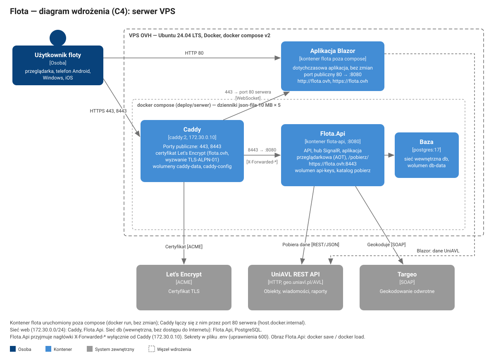

# Wdrożenie serwera Flota

Procedura dla serwera VPS (OVH) z dotychczasową aplikacją Blazor i FlotaApp (Flota.Api z aplikacją przeglądarkową). Dotychczasowa aplikacja pozostaje bez zmian: ten sam kontener, konfiguracja i adres `http://flota.ovh`. Wdrożenie wykonuje Jurek. Pliki konfiguracji: [`deploy/serwer/`](../deploy/serwer/).



## Układ

| Kontener | Obraz | Porty | Rola |
|---|---|---|---|
| `flota` (poza compose, bez zmian) | `flota:latest` | publiczny 80 → 8080 | dotychczasowa aplikacja Blazor pod `http://flota.ovh` |
| `caddy` | `caddy:2` | publiczne: 443 (TCP i UDP), 8443 (TCP i UDP) | odwrotne proxy, certyfikat Let's Encrypt dla `FLOTA_DOMAIN`; 443 — dotychczasowa aplikacja Blazor przez HTTPS (przekazanie do portu 80 serwera, połączenie WebSocket) |
| `flota-api` | `FLOTA_API_IMAGE` | wewnętrzny 8080 | Flota.Api z aplikacją przeglądarkową pod `https://flota.ovh:8443` |
| `db` | `postgres:17` | brak (sieć wewnętrzna) | baza Flota.Api |

| Element | Konfiguracja |
|---|---|
| Sieci | `web` (Caddy, aplikacje; podsieć `FLOTA_NETWORK_SUBNET`, domyślnie 172.30.0.0/24), `db` (wewnętrzna, bez dostępu do Internetu: Flota.Api, PostgreSQL) |
| Certyfikat | Let's Encrypt, wyzwanie TLS-ALPN-01 na porcie 443 (port 80 zajęty przez kontener `flota`; wyzwanie HTTP wyłączone); bez przekierowania HTTP → HTTPS |
| Port 443 | przeglądarki z automatycznym przejściem na HTTPS (Chrome, Edge) otwierają pod `flota.ovh` tę samą dotychczasową aplikację |
| Odwrotne proxy | Flota.Api przyjmuje `X-Forwarded-For` i `X-Forwarded-Proto` wyłącznie od adresu Caddy (`FLOTA_CADDY_IP`, domyślnie 172.30.0.10); schemat HTTPS z nagłówka — atrybut `Secure` ciasteczka sesji |
| Nazwa hosta | `AllowedHosts` Flota.Api = `FLOTA_DOMAIN` |
| Sekrety | wyłącznie w pliku `.env` na serwerze (wzór [`deploy/serwer/.env.example`](../deploy/serwer/.env.example)), uprawnienia 600 |
| Wolumeny | `db-data` (baza), `api-keys` (klucze Data Protection — szyfrowanie tokenów UniAVL w sesjach), `caddy-data` (certyfikaty), `caddy-config`; katalog `FLOTA_DOWNLOADS_DIR` (pakiet Android, tylko do odczytu) |
| Dzienniki kontenerów | `json-file`, `max-size` 10 MB, `max-file` 5 (każdy kontener) |
| Obraz Flota.Api | przenoszony plikiem (`docker save` / `docker load`), bez rejestru obrazów |

## Wymagania

- VPS z Ubuntu 24.04 LTS (aktualizacja systemu przed wdrożeniem), Docker Engine i docker compose v2 (`docker compose version`).
- DNS: rekord A domeny `flota.ovh` wskazujący adres serwera (rekord AAAA — przy adresie IPv6).
- Zapora: ruch przychodzący wyłącznie 80/TCP (dotychczasowa aplikacja), 443/TCP i UDP, 8443/TCP i UDP oraz SSH.
- Port 443 wolny (dotychczasowa aplikacja korzysta wyłącznie z portu 80).

### Stan serwera według notatek wdrożeniowych aplikacji Blazor

| Element | Wartość |
|---|---|
| Obraz | `flota:latest` — budowany lokalnie (`docker build -t flota .`), przenoszony plikiem (`docker save` / `docker load`); profil publikacji przewiduje także `grawasz/flota:latest` w Docker Hub |
| Kontenery | `flota` (`-p 80:8080`, `--restart unless-stopped`), `flota-old` (`-p 32785:8080`) |
| Konfiguracja uruchomienia | bez zmiennych środowiskowych i wolumenów; ustawienia regionalne `pl_PL.UTF-8` w obrazie |
| Inne kontenery | FloAPI (`-p 5000:8080`), Florea (`-p 5173:80`) — porty niekolidujące z Caddy; poza zakresem wdrożenia |
| Protokół | HTTP na porcie 80, bez certyfikatu — po wdrożeniu dodatkowo HTTPS na porcie 443 przez Caddy |

Stan bieżący do potwierdzenia przed wdrożeniem (port 80 przy kontenerze `flota`, porty 443 i 8443 wolne):

```bash
docker ps -a --format 'table {{.Names}}\t{{.Image}}\t{{.Ports}}\t{{.Status}}'
ss -tlnp | grep -E ':(80|443|8443)'
```

Kontenery `flota` i `flota-old` nie są zatrzymywane ani zmieniane.

## Przygotowanie obrazu (komputer deweloperski)

```powershell
./deploy/serwer/zapisz-obraz.ps1 -Katalog <katalog>
```

Skrypt buduje obraz z bieżącego zatwierdzenia (tag `flota-api:<skrót zatwierdzenia>`, build z kompilacją AOT — ok. 15–20 min) i zapisuje `flota-api-<skrót>.tar` z sumą kontrolną `.sha256`. Niezatwierdzone zmiany w repozytorium przerywają skrypt.

## Wdrożenie — krok po kroku

1. Katalog wdrożenia na serwerze, np. `/opt/flota`; kopiowanie plików z komputera deweloperskiego:
   ```bash
   scp deploy/serwer/docker-compose.yml deploy/serwer/Caddyfile deploy/serwer/.env.example \
       deploy/serwer/kopia-bazy.sh deploy/serwer/odtworz-baze.sh \
       <katalog>/flota-api-<skrót>.tar <katalog>/flota-api-<skrót>.tar.sha256 \
       <użytkownik>@<adres serwera>:/opt/flota/
   ```
2. Sprawdzenie i wczytanie obrazu:
   ```bash
   cd /opt/flota
   sha256sum -c flota-api-<skrót>.tar.sha256
   docker load -i flota-api-<skrót>.tar
   chmod +x kopia-bazy.sh odtworz-baze.sh
   ```
3. Plik `.env`:
   ```bash
   cp .env.example .env && chmod 600 .env
   openssl rand -base64 24   # POSTGRES_PASSWORD
   openssl rand -base64 32   # AUTH_SIGNING_KEY
   ```
   Uzupełnienie: `FLOTA_API_IMAGE=flota-api:<skrót>`, `POSTGRES_PASSWORD`, `AUTH_SIGNING_KEY`, `ACME_EMAIL` (zalecany), dane Targeo. `CADDY_CERTS` pozostaje pusty.
4. Uruchomienie:
   ```bash
   docker compose up -d
   docker compose ps
   docker compose logs -f caddy   # uzyskanie certyfikatu Let's Encrypt
   ```

## Sprawdzenie po wdrożeniu

| Sprawdzenie | Oczekiwany wynik |
|---|---|
| `http://flota.ovh` w przeglądarce | dotychczasowa aplikacja Blazor bez zmian |
| `https://flota.ovh` w przeglądarce | dotychczasowa aplikacja Blazor; logowanie, mapa i aktualizacja pozycji (połączenie WebSocket przez Caddy) |
| `curl -s https://flota.ovh:8443/health` | `Healthy` |
| `https://flota.ovh:8443` w przeglądarce | FlotaApp: logowanie, mapa, raport trasy; po przeładowaniu strony sesja zachowana |
| certyfikat (kłódka w przeglądarce, `curl -vI https://flota.ovh:8443`) | wystawca Let's Encrypt, domena `flota.ovh` |
| `docker compose ps` | porty publiczne wyłącznie przy kontenerze `caddy` (443, 8443) |
| `curl -s -o /dev/null -w '%{http_code}' https://flota.ovh:8443/downloads/android` | `404` bez pakietu w katalogu pobierania; `200` po umieszczeniu pliku `*.apk` |

## Aktualizacja Flota.Api

```bash
cd /opt/flota
./kopia-bazy.sh
sha256sum -c flota-api-<nowy skrót>.tar.sha256 && docker load -i flota-api-<nowy skrót>.tar
# .env: FLOTA_API_IMAGE=flota-api:<nowy skrót>
docker compose up -d flota-api
```

Poprzedni obraz pozostaje na serwerze (`docker image ls flota-api`) do czasu potwierdzenia działania nowej wersji.

## Pakiet Android do pobrania

Plik `*.apk` w katalogu `FLOTA_DOWNLOADS_DIR` (domyślnie `/opt/flota/pobierz`) jest udostępniany pod `https://flota.ovh:8443/pobierz/<nazwa>`; odnośnik pojawia się w aplikacji przeglądarkowej bez restartu usługi. Wersja przy odnośniku: `ANDROID_VERSION` w `.env` albo z manifestu pakietu. Pakiet do dystrybucji wymaga rozstrzygnięcia K9 (identyfikator aplikacji) i klucza podpisu wydania (T8.2).

## Kopia zapasowa

| Dane | Kopia |
|---|---|
| Baza (`db-data`) | `./kopia-bazy.sh` — `pg_dump` (format własny PostgreSQL) do `kopie/flota-<data>.dump`; przykład wpisu cron (codziennie 3:00): `0 3 * * * /opt/flota/kopia-bazy.sh` |
| Klucze Data Protection (`api-keys`) | `docker run --rm -v flota_api-keys:/k -v "$PWD/kopie":/b alpine tar czf /b/api-keys.tgz -C /k .` (nazwa wolumenu: `<katalog wdrożenia>_api-keys`, `docker volume ls`); utrata kluczy unieważnia sesje — wymagane ponowne logowanie |
| Certyfikaty (`caddy-data`) | bez kopii — wystawiane ponownie automatycznie |
| `.env` | kopia poza serwerem w bezpiecznym magazynie haseł |

Odtworzenie bazy (Flota.Api zatrzymywana na czas odtwarzania):

```bash
./odtworz-baze.sh kopie/flota-<data>.dump
```

## Wycofanie zmian

| Zakres | Działanie |
|---|---|
| Wersja Flota.Api | `.env`: poprzedni `FLOTA_API_IMAGE`; `docker compose up -d flota-api` |
| Dane bazy | `./odtworz-baze.sh kopie/<kopia sprzed aktualizacji>.dump` |
| Całe wdrożenie | `docker compose down` (bez `-v` — wolumeny zachowane) — stan sprzed wdrożenia; dotychczasowa aplikacja działa bez przerwy |

Schemat bazy tworzony przy pierwszym uruchomieniu (`EnsureCreated`; migracje po rozstrzygnięciu K6) — wycofanie wersji Flota.Api nie wymaga zmian schematu.

## Weryfikacja lokalna

Konfiguracja z `deploy/serwer/` uruchamiana lokalnie z atrapą dotychczasowej aplikacji na porcie 80 komputera (`docker-compose.test.yml`) i certyfikatami wewnętrznego urzędu Caddy (`CADDY_CERTS=lokalny` w testowym pliku `.env`, `FLOTA_API_IMAGE` — obraz zbudowany lokalnie):

```powershell
cd deploy/serwer
docker compose --env-file <testowy .env> -f docker-compose.yml -f docker-compose.test.yml up -d
curl.exe -s http://localhost/                                                   # Atrapa aplikacji Blazor
curl.exe -sk --resolve flota.ovh:443:127.0.0.1 https://flota.ovh/              # Atrapa aplikacji Blazor
curl.exe -sk --resolve flota.ovh:8443:127.0.0.1 https://flota.ovh:8443/health  # Healthy
docker compose --env-file <testowy .env> -f docker-compose.yml -f docker-compose.test.yml down -v
```

| Sprawdzenie | Wynik |
|---|---|
| 80 `/` (atrapa poza Caddy) | odpowiedź atrapy aplikacji Blazor |
| 443 `/` (Caddy → port 80 komputera) | odpowiedź atrapy aplikacji Blazor |
| 8443 `/health` | `Healthy` |
| 8443 `/` | `200`, `text/html` (aplikacja przeglądarkowa) |
| 8443 `/fleet/snapshot` bez tokenu | `401` |
| inna nazwa hosta (SNI) | połączenie odrzucone |
| porty publiczne compose | wyłącznie kontener `caddy` (443, 8443); port 80 — atrapa |
| adres Caddy / `ForwardedHeaders__KnownProxies__0` | `172.30.0.10` / `172.30.0.10` |
| dzienniki | `json-file`, `max-size` 10m, `max-file` 5 |
| kopia i odtworzenie bazy (`pg_dump` / `pg_restore`) | odtworzenie bez błędów, tabele `Addresses`, `Sessions`, `UserSettings` |
